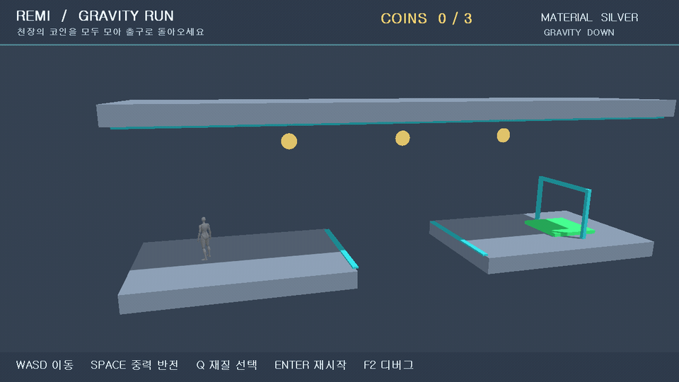

# REMI Engine

[한국어](README.md) · English

**C++20 · Direct3D 11 · HLSL · Win32 · Windows x64**  
Current version: **0.11.0**

REMI is a custom 3D game engine with independently implemented rendering, scene management, resource lifetime, physics, and job scheduling. Maze Escape is a third-person game built on the engine. Raven is a technical demo that compares Forward and Deferred PBR rendering and diagnostic features in the same scene. Gravity and Relay are separate games that reuse the common Scene, Physics, and Renderer systems.

## Start here

| Topic | What it shows |
| --- | --- |
| [Maze Escape](docs/MazeEscape.md) | A 13×13 maze assembled from Ancient Ruins assets, the Quinn mannequin, collision, camera, and game UI |
| [Raven Rendering](docs/RavenRendering.md) | Soul City and Raven, material inputs, PBR passes, Forward/Deferred switching, and limitations |
| [Engine Architecture](docs/Architecture.md) | Module dependencies, frame loop, and the boundary between RHI and D3D11 |
| [Rendering Pipeline](docs/RenderingPipeline.md) | Shadow, G-buffer, lighting, and post-processing order, plus the scope of GPU timing |
| [Resource & Memory](docs/MemoryManagement.md) | Ownership, generation-based handles, caching, reload, and failure recovery |
| [Measured GPU results](docs/benchmarks/RavenHardware-2026-10-11.md) · [Measured Job System results](docs/benchmarks/JobSystemHardware-2026-10-11.md) | Test conditions, raw CSV files, results, and limitations |

## Implemented systems

| System | Current implementation |
| --- | --- |
| Render / RHI | D3D11 resource and command abstraction; Forward and Deferred PBR; four G-buffers; directional and point lights; a 2048² shadow map with 3×3 PCF; bloom and tone mapping; frustum culling of static Scene meshes |
| Material / Asset | glTF/GLB meshes and Base Color, Normal, ORM, and Emissive textures; offline FBX-to-GLB conversion; `.remimat`; CPU MaterialGraph and node GC |
| Scene / Lifetime | Hierarchical transforms; generation-based EntityId; shared MeshHandle; file, mesh, and texture caches; reload that retains the previous resource on failure |
| Runtime / Jobs | Win32 input; fixed-timestep physics update; AABB collision; a Job System with up to eight workers for per-primitive glTF CPU preparation |
| Debug / Validation | Scene Inspector; performance overlay; culling, wireframe, and rendering-path toggles; CPU/GPU CSV output; regression tests |

Games assemble the common runtime through `Application` and `Layer`. `SceneRenderSession` groups shadow, color, and post-processing calls, while `Renderer` submits D3D11 commands through the `IRHI*` interface. GPU uploads and draw submission run on the main thread; only glTF CPU preparation is distributed to workers.

```text
Maze / Raven / Gravity / Relay
            ↓
Application · Input · Scene · Physics
            ↓
Resources · glTF Preparation · Job System
            ↓
SceneRenderSession · Renderer · RHI
            ↓
Direct3D 11 · Win32
```

## Measured results

### Raven scene: Forward/Deferred and frustum culling

Measured on 2026-10-11 with an **RTX 4070 Laptop GPU / i9-14900HX**, Release x64, 1920×1080, VSync OFF, and the D3D11 Debug Layer ON. Each condition used the same camera, 120 warmup frames, and 300 captured frames. CPU submission time, GPU interval time, and draw calls are medians.

| Path | Culling | CPU submission | GPU interval | Draw calls |
| --- | --- | ---: | ---: | ---: |
| Forward | OFF | 5.905 ms | 5.919 ms | 1,484 |
| Forward | ON | 1.777 ms | 2.180 ms | 513 |
| Deferred | OFF | 4.909 ms | 4.975 ms | 1,485 |
| Deferred | ON | 1.754 ms | 2.108 ms | 514 |

Culling static Scene meshes reduced draw calls by approximately **65.4%** in both paths. Median GPU interval time fell by **63.2%** in Forward and **57.6%** in Deferred; median CPU render submission time fell by **69.9%** and **64.3%**, respectively. Each condition was run once, so variability across repeated runs has not yet been validated. The GPU timestamp interval runs from the start of the shadow pass through the end of UI submission and excludes `Present`. These numbers therefore do not represent total frame time or an FPS improvement. [Raw CSV files and measurement scope](docs/benchmarks/RavenHardware-2026-10-11.md)

### Job System: glTF CPU preparation

On the same PC in Release x64, the Raven GLB was parsed once and its primitive references were used 1, 4, or 16 times. The medians below use eight workers, two warmup pairs and 30 measurements per mode, with alternating execution order.

| Raven workload | Sequential | Parallel | Speedup |
| --- | ---: | ---: | ---: |
| 1× · 124,242 vertices | 1.6080 ms | 0.7942 ms | 2.02× |
| 4× · 496,968 vertices | 6.6125 ms | 1.8412 ms | 3.59× |
| 16× · 1,987,872 vertices | 27.9521 ms | 6.8457 ms | 4.08× |

For a small 12-vertex fixture, sequential execution took **0.0011 ms** and parallel execution took **0.0258 ms**: queueing and synchronization overhead dominated. Fingerprints matched for every sequential and parallel output. The measured work comprises **vertex coordinate conversion and index winding changes**. It excludes file parsing, texture decoding, GPU upload, and total asset-loading time. [Raw CSV files and analysis](docs/benchmarks/JobSystemHardware-2026-10-11.md)

Earlier WARP 64×64 culling diagnostics and before/after comparisons for the resource cache and hierarchical deletion are kept separately in [PerformanceEvidence](docs/PerformanceEvidence.md). The WARP results are not combined with the real-GPU benchmark above.

## Demos and running the project

| Executable | Purpose | Assets and availability |
| --- | --- | --- |
| `REMIMazeEscape.exe` | Third-person Ancient Ruins maze and engine integration | Requires local Ancient Ruins GLB and Quinn assets |
| `REMIRaven.exe` | Raven PBR, Forward/Deferred, and culling comparisons in Soul City | Requires local Soul City and Raven assets |
| `REMIGravity.exe` | Gravity-reversal puzzle | Included in the public base package |
| `REMIRelay.exe` | Switch and time-limit game | Included in the public base package |
| `REMIVillage.exe` | African Slate Quarry exploration; executable name retained for compatibility | Requires local Quarry and Survival Character assets |
| `REMISandbox.exe` | Inspector and static-asset reload validation | Included in the public base package |



### Local executable folder

`demoexecutionfiles/` is a **local executable bundle** produced on this PC. It contains third-party assets, is excluded from Git, and is separate from the public release ZIP. Once prepared, `REMIMazeEscape.exe`, `REMIRaven.exe`, `REMIGravity.exe`, and the other executables can be launched from that folder. Launchers such as `Play-MazeEscape.cmd` and `Play-Quarry.cmd` set paths relative to the same folder.

If a Release build already exists, the command below refreshes the executable bundle. `-SkipBuild` copies existing executables and required local assets without building or launching a game.

```powershell
powershell -ExecutionPolicy Bypass -File tools\package\build-demoexecutionfiles.ps1 -SkipBuild
```

### Build with Visual Studio

Requirements: Windows 10/11 x64, Visual Studio 2022 with **Desktop development with C++** and a Windows SDK, and CMake 3.25 or later. Run `cmake --preset vs2022-x64` from the repository root, then open `build/vs2022-x64/REMI.sln` in Visual Studio. Select **Release | x64** and the desired game target (`REMIMazeEscape`, `REMIRaven`, etc.) as the startup project. The games' working directory is set to the repository root.

```powershell
cmake --preset vs2022-x64
cmake --build --preset release --target REMIMazeEscape REMIRaven
ctest --preset release
```

Prepare the lightweight Maze GLB with `tools/assets/prepare_ancient_ruins.py`, convert Raven with `tools/assets/import-raven.ps1`, and convert Quarry with `tools/assets/build-quarry-assets.ps1`. The source assets are left intact; converted outputs go into `build/local-assets/`. [Maze setup and controls](docs/MazeEscape.md) · [Raven conversion and controls](docs/RavenRendering.md) · [glTF/FBX pipeline](docs/AssetPipeline.md)

In Raven, `F1` toggles the performance overlay, `F2` culling, `F3` the Inspector, `F4` wireframe, and `F6` the Forward/Deferred path. In Maze, `F1` toggles culling and `F2` the top-right HUD; `F3`, `F4`, and `F6` have the same functions. Settings and help panels use Noto Sans KR. Gravity's separate HUD uses Pretendard.

### Public base package

`tools/package/build-release.ps1` builds Release from a source snapshot, runs CTest and executable checks, and creates a Windows x64 ZIP containing Gravity, Relay, and Sandbox. Maze, Raven, Quarry, and their third-party assets are not included in that ZIP. No executable ZIP has been uploaded to GitHub Releases yet. [Package contents and build instructions](tools/package/README.md)

## Repository layout

```text
engine/             Shared runtime, Scene, resources, Renderer, D3D11 RHI
games/              Maze Escape, Gravity, Relay, Village/Quarry, Raven demo
apps/               Sandbox Inspector and minimal Bootstrap
shaders/            HLSL rendering passes
assets/fonts/       Runtime fonts and licenses
tools/assets/       FBX, Unreal, and Ancient Ruins asset conversion
tools/benchmarks/   GPU and Job System measurement tools
tools/package/      Local executable bundle and public ZIP generation
tests/              Regression tests and small glTF fixture
docs/               Design documentation and raw measurements
media/              Public demo images
```

`build/`, `demoexecutionfiles/`, and `versions/` are Git-ignored local outputs and development records. Ancient Ruins, Quarry, and Survival Character source assets are in local folders; the Raven ZIP is in `Models/`; and Soul City source assets are in a separate Unreal project. These third-party assets are not included in the public source repository or base release ZIP. The repository's engine code is custom; `third_party/` and fonts follow their respective licenses.

## Current limitations

The RHI defines resource, command, and surface boundaries, but parts of the shadow map, G-buffer, and GPU query implementation remain tied to D3D11. Raven uses a static pose and does not recreate the original game's skin subsurface scattering, hair anisotropy, IBL, or lighting. glTF skeletal skinning uses a CPU path, and the Inspector is a development tool without save or undo. Performance has not been generalized across other GPUs or repeated runs.

For more implementation details, see [ShaderImplementation](docs/ShaderImplementation.md), [AssetPipeline](docs/AssetPipeline.md), and [PortfolioBenchmarks](docs/PortfolioBenchmarks.md).
